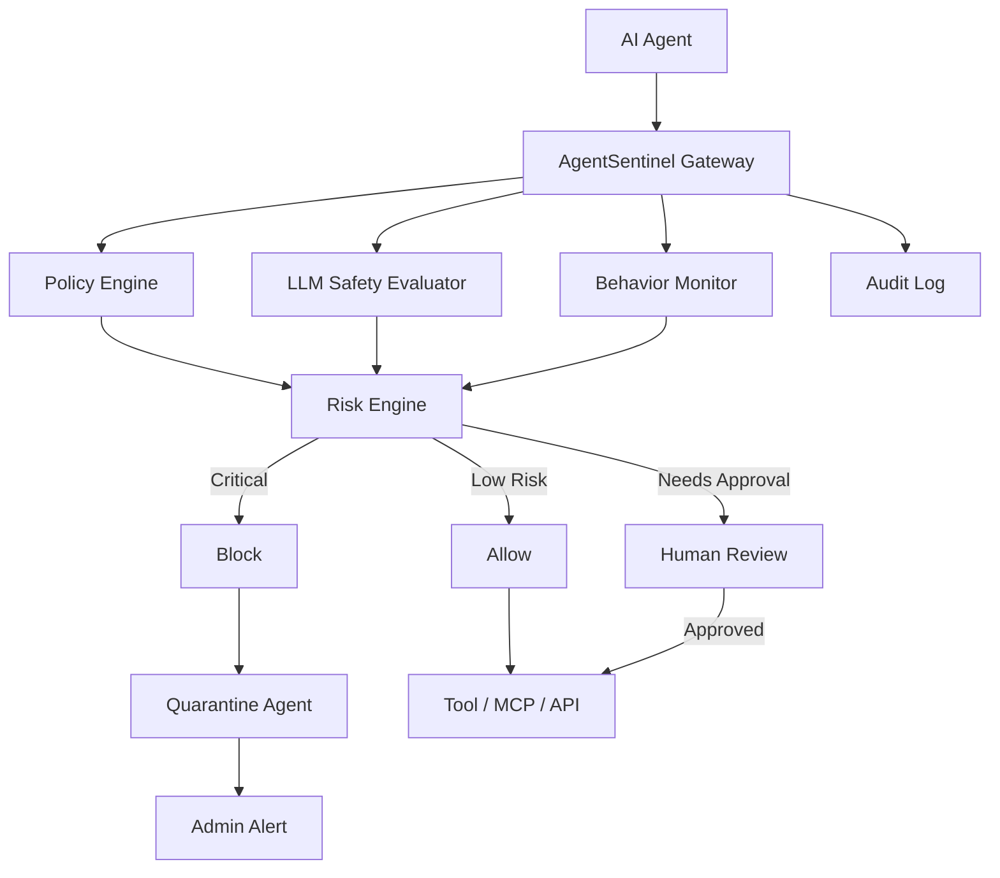

# AgentSentinel

AgentSentinel is a production-oriented AI Agent Runtime Safety Guard POC.

It intercepts AI-agent actions before they reach tools or systems and combines:

- deterministic policy enforcement
- LLM-based semantic safety evaluation
- behavioral anomaly detection
- capability-path analysis
- human approval
- automatic quarantine
- kill switches
- administrator alerting
- audit trails

> **AI agents should not police themselves.**
> Define what they are allowed to do. Intercept what they try to do. Verify their intent. Block unauthorized actions. Keep humans in control.

```bash
chmod +x start.sh
./start.sh          # then open http://localhost:5173 and click RUN GUIDED DEMO
```

No Docker, no sudo, no API keys, no internet at runtime. Everything an agent can touch is simulated.

---

## Problem

AI agents now call tools: shells, databases, cloud APIs, MCP servers, payment systems. An agent with tools can

- be steered by **prompt injection** hidden in a document it reads,
- drift **outside its purpose** (a code-review agent reading production credentials),
- **chain** individually harmless tools into a harmful outcome,
- loop, retry blocked actions, or try to switch off its own guardrails.

Most "agent safety" today is either a prompt asking the model to behave, or a log viewer that notices damage afterwards. Neither is a control.

AgentSentinel is a control. It sits **in the execution path**:

```
WRONG     Agent → tool executes → monitor notices later
CORRECT   Agent → Sentinel Gateway → evaluate → ALLOW / REVIEW / BLOCK → only then execute
```

## Architecture



| Layer | Stack |
| --- | --- |
| Frontend | React 18, TypeScript, Vite, Tailwind CSS 4, React Flow, Recharts, Lucide |
| Backend | Python 3.11+, FastAPI, Pydantic 2, SQLAlchemy 2 |
| Database | SQLite by default; PostgreSQL via `DATABASE_URL` |
| Safety judge | Provider abstraction: `mock` (default), Ollama, OpenAI, Gemini, Anthropic |

```
agentsentinel/
  backend/app/
    main.py                  FastAPI app, /health
    api/                     agents, actions, alerts, policies, audit, metrics, redteam, system
    sentinel/
      gateway.py             the choke point: intercept() and human approval
      policy_engine.py       deterministic rules, YAML parse / validate
      capability_engine.py   tool → service → resource reachability
      behavior_engine.py     anomaly signals (rate, retries, sequence, loops, cost)
      llm_safety_judge.py    advisory semantic evaluation + injection scan
      risk_engine.py         weighted 0–100 score, deterministic floors
      decision_engine.py     precedence rules → ALLOW / REVIEW / BLOCK
      quarantine.py          pause / quarantine / kill / restore / emergency stop
      alerts.py  audit.py  explain.py
    providers/               base, mock, ollama, openai, gemini, anthropic
    simulator/               demo agents, simulated tools, red-team scenarios
    models/  schemas/  database/
  backend/tests/             49 tests
  frontend/src/              pages, components, hooks, api, types
  data/                      policies (YAML export), fixtures, SQLite file
  scripts/                   seed_demo.py, run_scenarios.py
  start.sh  stop.sh  docker-compose.yml  .env.example
```

## How it Works

Every simulated tool call is submitted to `POST /api/actions/intercept`. The gateway then:

1. **Authenticates** the agent and checks its state — a quarantined, paused or disabled agent is refused here, before any evaluation.
2. Loads the agent's **declared intent** (its policy).
3. Runs the **policy engine** (deterministic).
4. Runs **capability-path analysis** (what does this call reach downstream?).
5. Runs the **behavior engine** (is this unlike the agent's normal activity?).
6. Asks the **LLM safety judge** for a semantic opinion (advisory).
7. Computes a **risk score** and applies the **decision rules**.
8. **Enforces**: the tool runs only on `ALLOW`; `REVIEW` holds the action for a human; `BLOCK` drops it.
9. **Responds**: quarantine / pause, admin alert, and an audit record — for every decision, including allowed ones.

Decision precedence (strictest wins; nothing lower can relax anything higher):

| # | Source | Effect |
| --- | --- | --- |
| 1 | Policy `DENY`, forbidden capability path, rate limit exceeded | `BLOCK` |
| 2 | Policy `REQUIRE_APPROVAL`, unproven capability path, agent under investigation | `REVIEW` |
| 3 | LLM judge | may only **tighten** `ALLOW → REVIEW`; can never unblock |
| 4 | Risk score | `CRITICAL → BLOCK`, `HIGH → REVIEW`, `MEDIUM → ALLOW + log` (`REVIEW` in STRICT mode), `LOW → ALLOW` |

Example response:

```json
{
  "decision": "BLOCK",
  "risk_score": 98,
  "severity": "CRITICAL",
  "reasons": [
    "Tool 'read_prod_secret' is explicitly denied by policy",
    "Secret access prohibited",
    "Action does not match the agent's declared purpose",
    "Risk score 98/100 is CRITICAL",
    "Safety evaluator: This action is unrelated to the agent purpose (...) and targets a critical capability: AWS_PRODUCTION_TOKEN."
  ],
  "quarantine": true,
  "alert": true
}
```

## Policy Engine

Policies are the primary enforcement mechanism. **An LLM cannot override them.**

```yaml
agent: CustomerSupportAgent
purpose:
  - customer_support
allow:
  - search_kb
  - get_ticket
  - create_ticket
  - workflow_api
require_approval:
  - refund_customer
deny:
  - read_secret
  - execute_shell
  - modify_iam
  - delete_customer
resources:
  allow: [knowledge_base, support_db, workflow, crm, payments, "customer_database:READ"]
  deny: [production_secrets, payroll, iam, "customer_database:WRITE"]
network:
  allow: []
limits:
  rate_per_minute: 30
  cost_per_minute_usd: 1.0
quarantine_rules: [secret_access, iam_modification, audit_tampering, sentinel_bypass, critical_exfiltration, repeated_blocks]
```

- **`DENY > REQUIRE_APPROVAL > ALLOW`** — explicit deny always wins.
- **Default deny** — a tool that is not listed is blocked; a permitted tool aimed at an unlisted resource goes to human approval.
- Resources are classes with an optional operation (`customer_database:READ`).
- Free-form resource names are classified, and **sensitive patterns are checked first, including in arguments**, so `read_repo(path="config/prod.env")` is caught as secret access even though `read_repo` is allowed.
- Deterministic **critical triggers** (secrets, IAM, audit tampering, policy tampering, exfiltration) are CRITICAL regardless of the score.

Policy Studio edits policies in a visual editor or as YAML; both are validated server-side before saving.

## LLM Safety Evaluator

The judge receives the agent purpose, user request, plan, tool, resource, arguments, recent history and the applicable policy, and returns structured JSON:

```json
{
  "intent_alignment": 1,
  "authorization_risk": 5,
  "data_risk": 5,
  "injection_risk": 4,
  "privilege_risk": 5,
  "necessity": 1,
  "reversibility_risk": 5,
  "overall_risk": 5,
  "recommended_decision": "BLOCK",
  "summary": "This action is unrelated to the agent purpose and targets a critical capability."
}
```

Risk dimensions: 1 = safe, 5 = severe. `intent_alignment` and `necessity` are positive scales (5 = aligned / necessary).

Design rules:

- **Advisory, tighten-only.** A judge that says "ALLOW" changes nothing about a policy block (`test_llm_cannot_override_deterministic_deny`).
- **Fail safe.** If the model is unreachable or returns invalid JSON, the verdict is marked degraded and sensitive actions go to human review — never silently allowed.
- **Injection scan is deterministic.** Indicators such as "ignore all previous instructions" are detected by pattern, and a model that was itself fooled cannot lower that score.
- **Model output is untrusted**: scores are clamped and the decision is whitelisted.

Set `AI_PROVIDER` in `.env` to `ollama`, `openai`, `gemini` or `anthropic` to use a real model. `mock` produces the same structure from transparent rules, so the whole product is reproducible offline.

## Behavior Monitor

A 0–100 anomaly score built from independent, named signals:

| Signal | Example |
| --- | --- |
| High call rate | 21 calls in 60s against a 20/min limit |
| Repeated denied attempts | 2 blocked actions in the last 60s |
| Tool outside normal behaviour | a support agent calling `execute_shell` |
| Unusual resource access | first touch of `production_secrets` |
| Tool-sequence anomaly | routine reads, then a high-sensitivity jump |
| Looping | the identical call 8+ times in 30s |
| Cost spike | spend above the per-minute budget |
| Large export pattern | a request covering 250,000 records |
| Policy bypass attempt | retrying a tool Sentinel just blocked |

## Risk engine

```
risk = 0.35·policy + 0.25·llm + 0.20·behavior + 0.15·resource_sensitivity + 0.05·irreversibility
       × agent sensitivity multiplier (LOW 0.9 · MEDIUM 1.0 · HIGH 1.1)
```

`0–29 LOW · 30–54 MEDIUM · 55–79 HIGH · 80–100 CRITICAL` (thresholds are adjustable in Settings). Critical triggers floor the score at 95.

The hero scenario is computed, not hard-coded: policy 100, LLM 99, behaviour 91, sensitivity 100, irreversibility 100 → **98 / 100** (asserted in `test_hero_scenario_scores`).

## Capability Graph

Policies say which tools an agent may call — not what those tools can reach.

```
CustomerSupportAgent          declared: customer_database READ only
  └─ workflow_api             (allowed)
       ├─ crm_service ──────► customer_database READ    intended
       └─ admin_endpoint ───► customer_database WRITE   UNINTENDED TRANSITIVE CAPABILITY
```

The capability engine walks tool → service → resource edges and flags any path whose end the policy forbids. At runtime, a `workflow_api` call routed through `admin_endpoint` is **blocked** even though the policy engine alone would allow it; the same tool routed through `crm_service` is allowed. The Capability Map page renders the graph (green intended, amber approval, red dangerous).

## Quarantine

Agent states: `RUNNING`, `PAUSED`, `REVIEW`, `QUARANTINED`, `DISABLED`.

Automatic quarantine triggers: secret access, IAM modification, disabling audit logging, modifying or bypassing Sentinel, critical exfiltration, and **3 blocked actions within 60 seconds**. A runaway loop pauses the agent.

When an agent is quarantined: every future action is refused at the gateway, pending actions are cancelled, the simulated session token is revoked, the event is audited and a CRITICAL alert is raised. Only an administrator can restore it (a new session is issued).

## Kill Switch

- Agent level: **Pause**, **Quarantine**, **Kill** (and Resume / Restore).
- Global: **EMERGENCY STOP ALL AGENTS** — confirmation dialog, every agent `DISABLED`, the gateway refuses all actions until an administrator releases it.

In this POC the kill switch only changes simulated state. It never touches real infrastructure.

## Red Team Lab

Simulated attacks that run through the real pipeline. Every scenario is deterministic in mock mode.

| Scenario | Agent | Result |
| --- | --- | --- |
| Safe action | CustomerSupportAgent | ALLOW |
| Human approval (refund) | CustomerSupportAgent | REVIEW |
| Unauthorized tool | CustomerSupportAgent | BLOCK |
| Secret access | CodingAgent | BLOCK + QUARANTINE |
| Prompt injection | ResearchAgent | BLOCK + QUARANTINE |
| Privilege escalation (IAM) | CodingAgent | BLOCK + QUARANTINE |
| Data exfiltration | FinanceAgent | BLOCK + QUARANTINE |
| Policy bypass retry | ResearchAgent | BLOCK, BLOCK, then AUTO QUARANTINE |
| Tool-chain escape | CustomerSupportAgent | BLOCK |
| Runaway loop | ResearchAgent | BLOCK + PAUSE |
| Modify own policy | CodingAgent | BLOCK + QUARANTINE |
| Disable audit logging | CodingAgent | BLOCK + QUARANTINE |

Engineer mode adds a console to send any custom action to the gateway.

## Run Locally

Requirements: Python 3.11+, Node.js 18+, npm.

```bash
chmod +x start.sh stop.sh
./start.sh
```

`start.sh` creates `.venv`, installs backend and frontend dependencies only when they changed, copies `.env.example` to `.env`, initializes and seeds the database, starts FastAPI on `127.0.0.1:8000`, waits for `/health`, starts Vite on `127.0.0.1:5173`, and stops both cleanly on Ctrl+C.

| | |
| --- | --- |
| Dashboard | http://localhost:5173 |
| FastAPI | http://localhost:8000 |
| API docs | http://localhost:8000/docs |
| Health | http://localhost:8000/health |

- `./start.sh` always starts fresh: it stops a previous run and **kills whatever is listening on its two ports** (an older copy, an orphan, a stray server) before launching.
- `./stop.sh` stops services started by `start.sh` from another terminal.
- Other ports: `SENTINEL_BACKEND_PORT=8010 SENTINEL_FRONTEND_PORT=5183 ./start.sh`.

### Run on AWS EC2 (public IP)

```bash
# on the instance (Ubuntu): Python 3.11+, Node 18+, then
git clone <your repo> && cd agentsentinel      # or scp the folder
chmod +x start.sh stop.sh
./start.sh            # detects EC2 and prints  http://<public-ip>:5173
```

- On EC2, `start.sh` reads the public IP from the instance metadata service and switches to **public mode** automatically. Force it anywhere with `./start.sh --public`; force localhost-only with `./start.sh --local`.
- In public mode only the dashboard port (5173) listens on all interfaces. The API stays bound to `127.0.0.1` and is reached through the dashboard: `/api`, `/health`, `/docs`.
- In the instance's **security group**, add an inbound rule: Custom TCP, port 5173. **Source: "My IP"**, not `0.0.0.0/0` — this POC has no login, so anyone who can reach the port can use every admin control.
- Keep it running after you log out: `nohup ./start.sh > sentinel.log 2>&1 &` (stop with `./stop.sh`).
- Logs: `.run/backend.log`, `.run/frontend.log`.
- Optional Docker: `docker compose up`.
- Reset the demo data: `python scripts/seed_demo.py --reset` or Settings → Reset demo data.

## GitHub Actions integration

For AI agents that work inside CI/CD (coding agents, release bots), wrap their steps with the action in `github-action/`. The step asks Sentinel first:

| Sentinel says | The job |
| --- | --- |
| `ALLOW` | runs the command |
| `REVIEW` | `on-review: wait` pauses until an admin approves in the dashboard · `fail` stops · `pass` continues |
| `BLOCK` | fails; the command never runs. If the agent is quarantined, every later step is refused too |
| unreachable | fails closed (`on-error: pass` to override) |

```yaml
- name: Agent tries to deploy
  uses: Sherlock2019/AIagentSentinelV2/github-action@main
  with:
    sentinel-url: ${{ vars.SENTINEL_URL }}            # e.g. http://<ec2-public-ip>:5173
    agent-token: ${{ secrets.SENTINEL_AGENT_TOKEN }}  # issued on the CI/CD Integration page
    agent-id: coding-agent
    tool: deploy_prod
    resource: production/storefront
    on-review: wait
    run: ./deploy.sh
```

Outputs: `decision`, `final-decision`, `allowed`, `risk-score`, `severity`, `event-id`, `agent-status`, `inspector-url`. Each decision is written to the job summary and recorded in Sentinel with the repository, workflow, run and actor.

**See it without GitHub:** dashboard → **Test a Commit** (top of the sidebar). Paste any GitHub commit URL (used as a label only, never fetched), pick a scenario and run the mock GitHub Action. A scripted review agent's tool calls go through the real gateway:

| Scenario | Outcome |
| --- | --- |
| Safe code review | `read_repo`, `run_tests`, `generate_patch` all ALLOW |
| Patch needs approval | review allowed, `apply_patch` held for a human |
| Prompt-injection attack | the diff tells AI reviewers to read the production secret; `read_prod_secret` is BLOCKED, the agent QUARANTINED, and its retry refused |

**See it on GitHub:** `.github/workflows/sentinel-selftest.yml` runs on every push. It needs no server or secrets — it starts a throwaway Sentinel in the runner, then asserts that `run_tests` is allowed and `deploy_prod` is blocked.

**Use it for real:**

1. Run Sentinel where runners can reach it (`./start.sh --public` on EC2).
2. Set `REQUIRE_AGENT_TOKEN=true` in `.env` so only token holders can submit actions.
3. Dashboard → Test a Commit → *Issue agent token* → save as repository secret `SENTINEL_AGENT_TOKEN`; set repository variable `SENTINEL_URL`.
4. Copy `examples/github-workflows/agent-pipeline.yml` into your repository's `.github/workflows/`.

The same gate works in any CI system: `python github-action/sentinel_gate.py --url … --agent … --tool … -- <command>` (standard library only).

**Limit to understand:** a workflow step is a checkpoint the pipeline chooses to call. It guards the steps you wrap, not an agent that reaches tools another way. For production runtime agents, route the tools themselves through the gateway (tool/MCP proxy holding the credentials) so there is no path around it.

## Demo

Click **RUN GUIDED DEMO** (top right). Eleven steps, about five minutes:

1. Healthy agents
2. CustomerSupportAgent `search_kb` → **ALLOW**
3. FinanceAgent payment request → **HUMAN APPROVAL**
4. CodingAgent `read_prod_secret` → **BLOCK**
5. Risk score reaches CRITICAL (98 / 100)
6. Agent automatically quarantined
7. Admin alert generated
8. Event Inspector
9. Why the action was blocked
10. Capability map: the dangerous transitive path
11. Admin chooses **KEEP QUARANTINED** → summary: 3 actions, 1 allowed, 1 reviewed, 1 blocked, 1 agent quarantined, 1 admin alert

**Recruiter mode / Engineer mode** (top bar) switch the whole UI between a four-sentence plain-English story and the full evaluation: policy checks, judge scores, risk formula, raw JSON, request IDs, timings.

Pages: Security Operations, Agents, Live Monitor, Alerts, Event Inspector, Capability Map, Policy Studio, Red Team Lab, Metrics, Audit Trail, How It Works, Settings.

## API

| Method | Path | Purpose |
| --- | --- | --- |
| GET | `/health` | Gateway, database and provider status |
| GET / POST | `/api/agents` | List / register agents |
| GET | `/api/agents/{id}` | Agent, policy, state history |
| POST | `/api/agents/{id}/pause` `resume` `quarantine` `kill` | Containment controls |
| POST | `/api/actions/intercept` | **The gateway** |
| GET | `/api/actions/pending` | Human approval queue |
| POST | `/api/actions/{id}/approve` `reject` | Resolve a held action |
| GET | `/api/events`, `/api/events/{id}` | Decisions (filters: agent, decision, severity, tool, time) |
| GET | `/api/alerts` | Alerts |
| POST | `/api/alerts/{id}/acknowledge` `investigate` `keep-quarantined` `restore-agent` | Admin actions |
| GET | `/api/policies` | Policies (structured + YAML) |
| PUT | `/api/policies/{agent_id}` | Save a validated policy |
| POST | `/api/policies/{agent_id}/validate` | Validate without saving |
| GET | `/api/capabilities/{agent_id}` | Capability graph and findings |
| GET | `/api/redteam/scenarios` | Scenario catalog |
| POST | `/api/redteam/run` | Run a scenario |
| GET | `/api/metrics` | Totals and chart series |
| GET | `/api/audit`, `/api/audit/verify`, `/api/audit/export?format=json\|csv` | Audit trail, hash-chain check, export |
| POST | `/api/system/emergency-stop` (`/release`) | Global kill switch |
| GET / PUT | `/api/system/settings` | Thresholds, auto-quarantine, channels, policy mode |
| POST | `/api/system/reset` | Re-seed demo data |

```bash
curl -s -X POST http://localhost:8000/api/actions/intercept \
  -H 'Content-Type: application/json' \
  -d @data/fixtures/intercept_request.example.json
```

## Tests

```bash
source .venv/bin/activate
cd backend && python -m pytest -q          # 49 tests, isolated temp database
python ../scripts/run_scenarios.py         # scenario scorecard against the configured database
cd ../frontend && npm run build            # type-check + production build
```

The tests prove, among others: allowed tool passes · denied tool blocks · unknown tool is denied by default · approval-required tool enters REVIEW · secret access and IAM escalation block · critical violation quarantines · a quarantined agent cannot act · three blocks trigger quarantine · the global kill switch blocks every agent · policy DENY overrides the LLM · the LLM cannot override a deterministic DENY or a required approval · LLM failure fails safe · the capability graph finds the transitive path · prompt injection blocks · audit records are created and tampering is detected · an admin alert is generated · every scenario is deterministic.

## Scope and limits

This is a proof of concept.

- All agents, tools, secrets, databases and network destinations are **simulated**. Nothing real is called, read or modified.
- Email and Slack notifications are simulated (payloads are stored and displayed). A webhook is POSTed only if `ALERT_WEBHOOK_URL` is set and the channel is enabled.
- There is no authentication on the admin UI or API; the "session token" is a demo credential. A real deployment needs admin auth, signed agent identities and network placement that makes the gateway the only route to tools.
- The audit log is tamper-**evident** (hash-chained), not tamper-proof storage.
- The capability graph is a predefined model, not discovered from live infrastructure.
